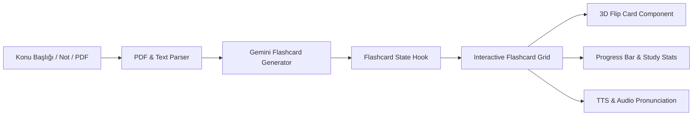

# 🗂️ Flashcard Generate - AI-Powered Learning & Smart Flashcard Studio

[](https://www.typescriptlang.org/)
[](https://reactjs.org/)
[](https://vitejs.dev/)
[](https://deepmind.google/technologies/gemini/)
[](https://www.yucelgumus.dev/)

> Herhangi bir konudan, metinden veya PDF dokümanından **Google Gemini AI** kullanarak otomatik olarak soru-cevap bilgi kartları (flashcards) üreten, 3D kart çevirme animasyonları, sesli okuma ve öğrenme takip sistemi sunan interaktif çalışma platformu.

---

## 🌟 Öne Çıkan Özellikler

- 🤖 **Yapay Zeka ile Otomatik Kart Üretimi:** Konu başlığı, özel notlar veya PDF yüklemesi üzerinden zorluk derecesine göre optimize edilmiş soru-cevap çiftleri üretir.
- 🔄 **3D Kart Çevirme (Flip Animation):** Gerçekçi 3D CSS efektleriyle soru ve cevap arasında pürüzsüz geçiş.
- 📊 **Öğrenme İlerleme Çubuğu (Progress Tracking):** *"Öğrenildi"*, *"Tekrar Edilecek"* işaretlemeleri ile çalışma oturumunun tamamlanma oranını anlık takip etme.
- 🔊 **Sesli Telaffuz & TTS Desteği (`useAudio`):** Yabancı dil veya kavram kartları için metin okuma desteği.
- 💾 **Yerel Hafıza (LocalStorage):** Oluşturulan kart setlerini tarayıcıda kalıcı olarak saklama ve tekrar çalışma imkanı.

---

## 🏗️ Mimari & Modül Yapısı



| Modül | Açıklama |
| :--- | :--- |
| **`src/services/ai.service.ts`** | Gemini AI ile yapılandırılmış JSON flashcard üretimi |
| **`src/hooks/useFlashcards.ts`** | Kart durumları, filtreleme ve LocalStorage senkronizasyonu |
| **`src/hooks/useAudio.ts`** | Web Speech API / TTS sesli okuma kancası |
| **`src/components/Flashcard/`** | 3D döndürülebilir kart görsel bileşeni |

---

## 🚀 Hızlı Başlangıç

### Gereksinimler
- **Node.js**: v18.0 veya üzeri
- **Google Gemini API Key**

### Kurulum

```bash
# Depoyu klonlayın
git clone https://github.com/yucel-gumus/flashcard_generate.git
cd flashcard_generate

# Paketleri yükleyin
npm install
```

### Ortam Değişkenleri (`.env`)

```env
VITE_GEMINI_API_KEY=your_gemini_api_key_here
```

### Başlatma

```bash
npm run dev
```

Tarayıcınızda `http://localhost:5173` adresine giderek kart setleri oluşturmaya başlayabilirsiniz.

---

## 📂 Proje Dizin Yapısı

```
flashcard_generate/
├── api/
│   └── generate.ts                 # Serverless kart üretim API
├── index.html
├── package.json
├── vite.config.ts
└── src/
    ├── main.tsx
    ├── App.tsx
    ├── types/flashcard.types.ts    # Kart ve oturum tipleri
    ├── utils/
    │   ├── pdf.utils.ts            # PDF metin çıkarıcı
    │   └── parser.utils.ts         # JSON & metin temizleme
    ├── hooks/
    │   ├── useFlashcards.ts        # Kart yönetimi
    │   └── useAudio.ts             # Ses entegrasyonu
    ├── services/
    │   └── ai.service.ts           # Gemini prompt mühendisliği
    └── components/
        ├── Flashcard/              # 3D Flip Card
        ├── FlashcardGrid/          # Kart ızgarası
        └── ProgressBar/            # İlerleme çubuğu
```

---

## 📄 Lisans
Bu proje [MIT Lisansı](LICENSE) ile lisanslanmıştır.

---

## 👨‍💻 Geliştirici & İletişim

**Yücel Gümüş** - Full Stack Developer

- 🌐 **Web Sitesi / Portfolyo:** [yucelgumus.dev](https://www.yucelgumus.dev/)
- 💼 **LinkedIn:** [linkedin.com/in/yucel-gumus](https://www.linkedin.com/in/yucel-gumus/)
- 🐙 **GitHub:** [@yucel-gumus](https://github.com/yucel-gumus)

<p align="left">
  <a href="https://www.yucelgumus.dev/" target="_blank" rel="noopener noreferrer">
    
  </a>
</p>
